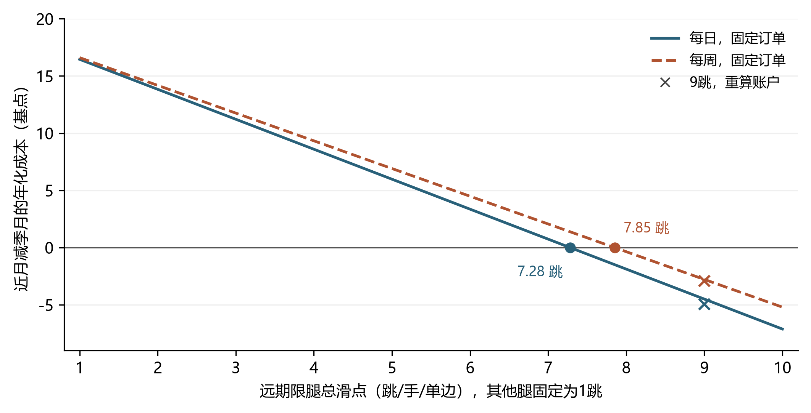

# 沪深300股指期货目标波动策略的交易代价

**移仓频率、流动性与期限结构 · 论文复现项目**

减少移仓次数究竟能省多少钱？本研究用中金所 IF 分合约行情重建四组目标波动账户，分别采用每日或每周调仓、按月或按季移仓。每个持有区间均按同一份合约的两次开盘价计算盈亏。账户以人民币计价，初始权益1亿元，目标年化波动率15%。评价期从2021年1月4日开盘至2025年12月31日开盘，共1,211个持有区间。

在每条交易腿平均滑点均为1跳的情景下，每日调仓账户改为按季移仓，成交额由权益的24.17倍/年降至10.19倍/年，预计年化节费16.46个基点。固定基础订单和逐日权益，远月腿平均滑点升至7.28跳时节费归零。改用多尺度回归信号后，更多日常订单落到远月，临界值降至4.07跳。手续费和滑点按情景估算，基差项按持有期的历史价格变化事后归因。



## 复现

下载并解压本仓库，或使用 Git 克隆。在仓库根目录运行以下命令。实测环境为64位 Python 3.14.6，主要依赖版本见 [requirements.txt](requirements.txt)。

```sh
python -m pip install -r requirements.txt
python reproduce.py
```

首次运行会从官方来源下载96个期货月档和5份年度指数行情，按 [data_sources.json](data_sources.json) 逐件校验 SHA-256，生成分合约面板，再依次运行四组账户、基差归因、季度重抽样、波动率预测与制图。相同版本的原始文件保存在 `data/`，再次运行可直接使用缓存。若官方网站暂时无法访问，也可按清单内的 `file` 路径手工放入同版本文件后运行。中文图形可使用微软雅黑、思源黑体或黑体。

最后，程序在终端列出论文数值及重算值，并将对照写入 `results/paper_comparison.csv`。核对基准见 [paper_results.csv](paper_results.csv)，按论文展示的小数位数比较11项结果。账户和预测的计算不读取这些目标值。可直接查看[此次独立运行的逐项对照](reproduction_check.csv)。

## 如何找到论文中的结果

| 论文位置 | 运行后查看 | 内容 |
| --- | --- | --- |
| 表1、图1 | `if_accounts.py` | 两种移仓日历、两种调仓频率，以及决定手数、开盘交易和结算估值的顺序 |
| 表2、图2 | `results/accounts_summary.csv`、`results/factor_effects.csv` | 四组账户的成交额、风险、净收益及双因素差值 |
| 表3、图3 | `results/breakeven.csv`、`results/accounts_summary.csv` | 费用分项、给定订单下的滑点平衡点及逐日重算的压力情景 |
| 表4、图4 | `results/market_liquidity.csv`、`results/market_year.csv` | 拆单前的订单规模、成交量占比及不同期限的基差 |
| 表5 | `results/market_account_bridge.csv`、`results/quarterly_intervals.csv` | 指数、基差、费用三项财富归因及成本与净收益差的季度抽样区间 |
| 表6、表7 | `results/signal_fits.csv`、`results/signal_loss_intervals.csv`、`results/signal_monthly_risk.csv`、`results/signal_thresholds.csv` | 多尺度信号的训练、预测评价、风险预算偏离与远月成本平衡点 |

三幅实证图的 PNG 和 SVG 在 `results/figures/`。原始重建订单在 `results/orders.csv.gz`，各账户逐日权益在 `results/accounts_daily.csv.gz`。模拟订单可用于追溯费用计算。

## 数据与口径

- **期货行情**取自[中国金融期货交易所历史数据](http://www.cffex.com.cn/yshsjxz/)。2018—2025年月档中提取 IF 分合约的开盘、收盘、结算、前结算、成交量与持仓量。面板共1,942个交易日、7,768条合约日记录。评价期前的记录供波动率估计和模型训练使用。合约乘数为每点每手300元，价格最小变动0.2点，每手1跳为60元。[IF合约表](http://www.cffex.com.cn/hs300/)
- **现货基准**采用中证指数有限公司公布的沪深300价格指数（000300）开盘与收盘点位。基差定义为期货点位减现货指数点位。年度查询地址及文件摘要见数据清单。[中证指数](https://www.csindex.com.cn/)
- **成本**按单边名义金额计0.23个基点交易所手续费、0.46个基点经纪加收。每笔申报按1元估算，每笔至多20手。基础情景每条腿平均滑点1跳。远月指成交时到期月份至少晚两个月的合约。[费用公示](https://www.huajinqh.com/UserFiles/upload/file/20250730/手续费标准表20250730.pdf) · [申报费说明](https://www.ciccwmf.cn/gsgg/73195.jhtml)
- **预测**使用前一收盘时已经可得的信息。30日滚动波动率与日频衰减系数0.94的 EWMA 为对照，多尺度模型使用1、5、22日收盘收益平方的特征，每年用此前已实现的标签重新训练。预测评价采用同日配对的 QLIKE 损失差，季度重抽样保留同一时期各方案的对应关系。[RiskMetrics 技术文档](https://www.msci.com/documents/10199/5915b101-4206-4ba0-aee2-3449d5c7e95a) · [Corsi, 2009](https://doi.org/10.1093/jjfinec/nbp001) · [Patton, 2011](https://doi.org/10.1016/j.jeconom.2010.03.034)

`month/quarter` 表示按月/按季移仓，`daily/weekly` 表示每日/每周调整手数，`base` 表示论文基础费用情景。年化按252个交易日折算，1基点等于0.01个百分点。`legacy_reference.csv` 是原统一费率对照账户的留存结果，专用于核对该对照规则。
